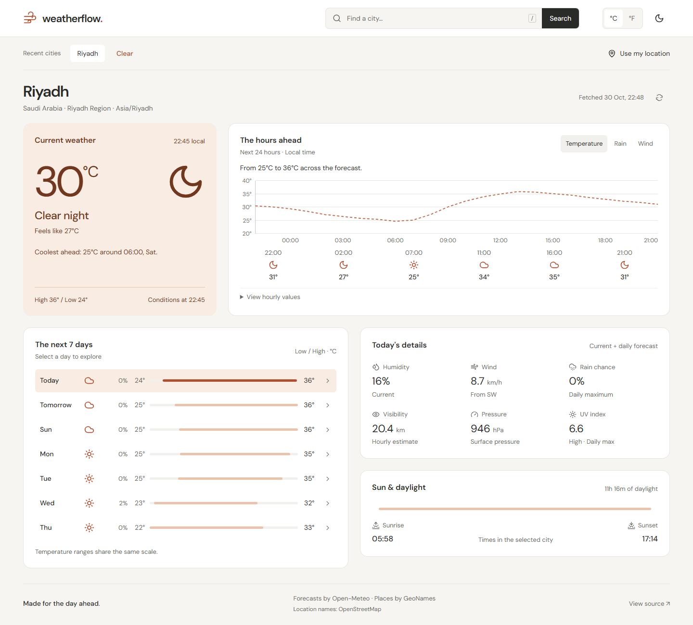
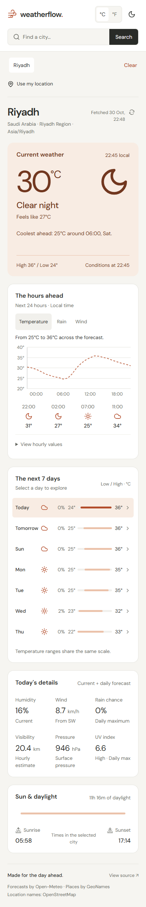

# WeatherFlow

A weather workspace for the day ahead. Search for a precise location, check current conditions, and explore hourly and seven-day forecasts. Built with HTML, CSS and vanilla JavaScript, with no runtime packages or build step.



## What's inside

- City search with region and country disambiguation. Recent-city controls distinguish duplicate names too, including same-country locations.
- Current conditions and an hourly temperature, rain-chance or wind chart, with a readable hourly table. Forecast lines are dashed.
- Seven days on one temperature scale. Selecting a day updates the hourly outlook, day-scoped details and sunrise/sunset together.
- Humidity, wind direction, surface pressure, visibility, UV maximum, precipitation probability and daylight duration. Each value states whether it is current, an hourly estimate, a daily average or a daily maximum.
- City-local dates and times from epoch timestamps, independent of the device timezone.
- Consistent metric/imperial conversion for temperature, wind, pressure and visibility.
- Light and dark themes, keyboard search shortcut `/`, Escape to close results, visible focus, screen-reader status announcements and reduced-motion support.
- Eight recent places, last-city restoration, and a labeled saved forecast when a same-day snapshot can be restored. Browser storage may be denied without breaking the app.
- Request cancellation, timeouts, retry, rate-limit handling, permission-denial guidance and honest missing-value states.

<details>
<summary>Mobile preview</summary>



</details>

## Run locally

Use an HTTP server because the app uses JavaScript modules. Opening `index.html` with `file://` is not supported.

```sh
git clone https://github.com/NAIFDev1/Weather-Dashboard.git
cd Weather-Dashboard
npm start
```

Open `http://127.0.0.1:4200/`. Node 22+ is used for the optional development server and tests; no `npm install` is necessary. Alternatively serve this directory with `python -m http.server 4200`.

## Check

```sh
npm run check
npm test
```

Ten invariant tests cover units, timezone and DST behavior, coordinate validation, same-name city identity, midnight boundaries, missing data, polar daylight, weather codes, API query construction and cancellation. [Verification notes](docs/verification.md) distinguish these tests from browser and live-service checks. GitHub Actions runs syntax checks and unit tests on pull requests and `main`.

## Data and privacy

Weather uses the [Open-Meteo Forecast API](https://open-meteo.com/en/docs). City search uses the [Open-Meteo Geocoding API](https://open-meteo.com/en/docs/geocoding-api), with GeoNames attribution. Only submitting a search requests city results; there is no keystroke autocomplete. Device location is requested only after clicking **Use my location**. The coordinates go to Open-Meteo for weather and to Nominatim for an optional readable locality name; if naming fails, the coordinates still identify the location.

Theme, units, coordinates, recent-city history and the latest forecast snapshot are stored only in the visitor's browser. A snapshot restores only for the same location, within 24 hours, and within its original city-local calendar day. The app attempts a fresh request on every visit. This is saved data recovery, not an offline-installable PWA: the application's files must still load. No accounts, analytics, backend, secrets or API keys are included.

The public API services can fail or throttle requests. Forecasts are model predictions; WeatherFlow does not provide official severe-weather alerts. The free public endpoints used by this portfolio project have their own usage terms; consult the providers before commercial deployment.

## Structure

| File | Purpose |
| --- | --- |
| `index.html` | Semantic interface and initial loading frame |
| `style.css` | Theme tokens, layout, responsive behavior and interaction states |
| `script.js` | Search, requests, persistence, UI rendering and interaction orchestration |
| `weather.js` | Validation, API query, date/number conversions and domain calculations |
| `assets/fonts/` | Self-hosted DM Sans variable font and SIL OFL license |
| `assets/icons.svg` | Existing weather icon sprite, reused with consistent strokes |
| `assets/vendor/charts.js` | Dependency-free chart helper adapted from the installed Taste skill; obsolete line renderers and observers are invalidated on change |
| `scripts/serve.mjs` | Optional local HTTP server |
| `tests/` | Node invariant tests |
| `DESIGN.md` | Implemented visual system |

## Hosting

The site is static and all application paths are relative, including modules, fonts and icons. The repository root can be served under a GitHub Pages project subpath such as `/Weather-Dashboard/`; no bundling or URL rewriting is required. This branch does not change Pages settings or deploy automatically. A merged source update still needs the repository's configured publishing process.
